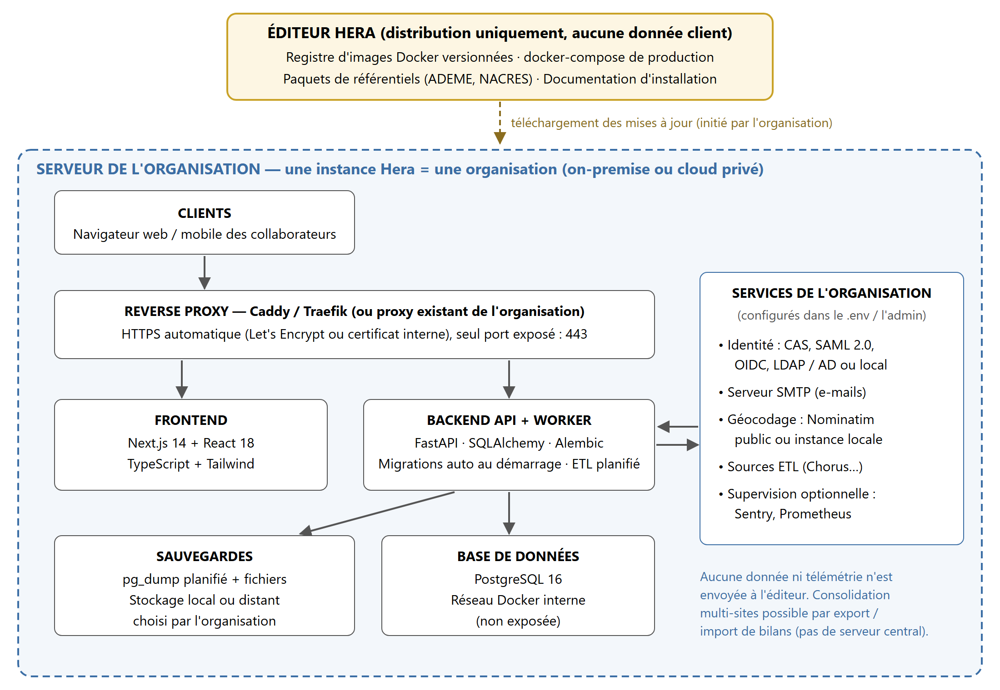

# Hera V2

**Hera** est une application de **comptabilité carbone** pour les organisations : laboratoires, entreprises, collectivités, associations. Elle calcule l'empreinte CO₂ :

- des **déplacements professionnels**, avec des missions en plusieurs étapes et des facteurs ADEME par mode de transport ;
- des **achats**, selon leur montant et leur code NACRES ;
- du **matériel informatique**, en comptant sa fabrication, son amortissement et sa consommation électrique ;

puis normalise ces résultats (CO₂ par ETP, par publication…) et produit des tableaux de bord et des rapports.

Hera V2 est la refonte complète d'un MVP en Streamlit, réalisé en 2025 au laboratoire Heudiasyc (UMR-CNRS 7253, UTC).

## Une instance par organisation (auto-hébergement)

Hera V2 **n'est pas une plateforme centralisée**. Chaque organisation installe **sa propre instance** sur son serveur ou son cloud privé, et reste seule détentrice de ses données.



- **Une instance = une organisation** : la base ne contient que les données de l'organisation qui l'héberge.
- **Distribution par Docker** : images versionnées, `docker-compose` de production et fichier `.env` documenté.
- **Intégration au système d'information** : le fournisseur d'identité se choisit par instance (CAS, SAML 2.0, OIDC, LDAP ou comptes locaux), tout comme le serveur SMTP et le reverse proxy.
- **Autonomie** : aucun service de l'éditeur n'est nécessaire et aucune télémétrie n'est envoyée. Les facteurs d'émission sont livrés avec chaque version, et on peut les mettre à jour en important un fichier.
- **Consolidation multi-sites** : un groupe à plusieurs sites rassemble ses bilans par export et import entre instances, sans serveur central.

## Stack technique

| Couche | Technologies |
|---|---|
| Backend | Python 3.11, FastAPI, Pydantic 2, SQLAlchemy 2 (async), Alembic |
| Base de données | PostgreSQL 16 |
| Frontend (à venir) | Next.js 14, React 18, TypeScript, Tailwind CSS, shadcn/ui, Recharts, React-Leaflet |
| Infrastructure | Docker, Docker Compose, Caddy ou Traefik |
| Tests | pytest et httpx (backend), Jest et Playwright (frontend) |

## Structure du dépôt

```
.
├── backend/              API FastAPI
│   ├── app/
│   │   ├── config/       paramètres (.env) et connexion à la base
│   │   ├── middleware/   authentification et permissions
│   │   ├── models/       modèles SQLAlchemy
│   │   ├── routes/       endpoints /api/v1/...
│   │   ├── schemas/      schémas Pydantic
│   │   ├── services/     logique métier (authentification, calcul CO₂)
│   │   └── utils/        seed des données initiales
│   ├── alembic/          migrations de base de données
│   └── tests/            tests pytest
├── docs/                 schémas et documentation
├── docker-compose.yml    environnement de développement
└── .env.example          modèle de configuration
```

## Démarrage en développement

Prérequis : Docker et Docker Compose.

```bash
cp .env.example .env          # puis adapter les valeurs (SECRET_KEY, mots de passe…)
docker compose up -d          # PostgreSQL + API sur http://localhost:8000
docker compose exec api python -m app.utils.seed   # rôles, permissions, facteurs, admin
```

- La documentation de l'API (Swagger) est sur http://localhost:8000/docs (avec `DEBUG=true`).
- Le seed crée un compte administrateur de développement, défini dans `backend/app/utils/seed.py`. Ce compte est à usage local uniquement.
- pgAdmin est disponible en option avec `docker compose --profile tools up -d`, sur http://localhost:5050.

### Tests

```bash
cd backend
pip install -e ".[dev]" aiosqlite
pytest
```

Les tests utilisent une base SQLite en mémoire et n'ont besoin d'aucun PostgreSQL.

## État d'avancement

| Module | État |
|---|---|
| Authentification et utilisateurs, rôles, permissions | API en place (comptes locaux) |
| Équipes | API en place |
| Missions et déplacements (calcul CO₂) | API en place |
| Achats (NACRES, calcul CO₂) | API en place |
| Matériel informatique (cycle de vie, CO₂) | API en place |
| Migrations Alembic | à générer |
| Métriques, dashboards, rapports, audit | à faire |
| CAS, SAML, OIDC, LDAP | à faire |
| Installation : assistant de premier démarrage, compose de production, sauvegardes | à faire |
| ETL (Playwright) | à faire |
| Frontend Next.js | à faire |

## Licence

Hera V2 est un logiciel libre distribué sous la licence **GNU Affero General Public License v3.0** ([AGPL-3.0](LICENSE)).

Concrètement :
- chacun peut utiliser, étudier, modifier et redistribuer Hera, y compris à des fins commerciales ;
- toute organisation peut l'héberger pour ses propres besoins ; si elle n'y change rien, elle n'a rien à publier ;
- quiconque distribue une version modifiée, **ou la met à disposition d'utilisateurs via le réseau** (par exemple sous forme de service en ligne), doit en fournir le code source à ces utilisateurs, sous la même licence.
